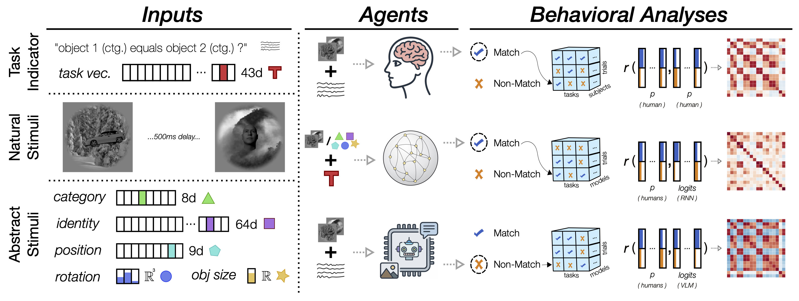

<div align="center">

# Pixels over Symbols

### Sensory Realism Improves Behavioral Alignment in Models of Cognition

[](https://neurips.cc/virtual/2026/poster/153571)
[](https://arxiv.org/abs/2611.10565)
[](https://huggingface.co/datasets/rdh1115/pixels-over-symbols)
[](https://github.com/rdh1115/abs_nat_psychopy_mturk)
[](LICENSE)

</div>

## Contents

- [Summary](#summary)
- [Environment](#environment)
- [Data](#data)
- [Quick start](#quick-start)
- [Reproducing the paper](#reproducing-the-paper)
- [Repository layout](#repository-layout)
- [Citation](#citation)
- [License](#license)

## Summary

Computational models of cognition usually replace sensory input with abstract symbolic vectors.
We test whether this simplification changes how human-like the models' behavior is.
We train recurrent and transformer models on 43 visual working-memory tasks from [iWISDM](https://github.com/BashivanLab/iWISDM) using the HvM stimuli dataset by [Majaj et al.](https://pubmed.ncbi.nlm.nih.gov/26424887/).

- **Abstract models** see a one-hot description of each stimulus.
- **Natural models** see the features of a frozen pretrained vision encoder.

Both are then compared trial by trial with human participants and vision-language models on the same 960 trials of 12 tasks.



The main findings:

- Natural models reproduce human trial-by-trial responses significantly more closely than Abstract models, though all models remain well below the consistency between humans.
- Vision-language models approach or exceed human accuracy, but fall behind most task-trained Natural models at reproducing the pattern of human responses.
- Recurrent weights trained on abstract inputs, frozen and driven by sensory-realistic inputs, recover the human consistency of Natural models, with dynamics within the seed-to-seed variability of Natural models.
- Sensory realism accounts for more of the model-human agreement than the choice of sequence architecture, and about as much as the choice of vision encoder.

This repository has the code to train every model in the paper, evaluate them on the human trials, and redraw the figures and statistics.
The data (de-identified human responses, VLM responses, trial lists, trained checkpoints and cached evaluations) is on Hugging Face at [rdh1115/pixels-over-symbols](https://huggingface.co/datasets/rdh1115/pixels-over-symbols).
The PsychoJS experiment we ran on Amazon Mechanical Turk is at [rdh1115/abs_nat_psychopy_mturk](https://github.com/rdh1115/abs_nat_psychopy_mturk).

## Environment

The analyses were run with the package versions pinned in `requirements.txt`.

```bash
conda create -n pixels python=3.12
conda activate pixels
pip install -r requirements.txt
```

The DSA fits its operators with the `DSA` package (`dsa-metric` on PyPI) and compares them with a batched version of that package's Procrustes solver in `analysis/dsa/simdist.py`.

## Data

Everything the code reads or writes lives under `data/` (see `utils/paths.py`).
We have made our data and model weights available on Hugging Face [here](https://huggingface.co/datasets/rdh1115/pixels-over-symbols).

```bash
hf download rdh1115/pixels-over-symbols --repo-type dataset --local-dir data
```

which gives

```
data/mturk/trials/       the 12 MTurk trial lists and the 100 stimuli they use (stim_subset.csv)
data/mturk/images/       those 100 stimuli as shown to participants
data/mturk/human/        participant responses, 20 per task, one CSV per participant (s01.csv to s20.csv)
data/mturk/vlm/          VLM responses, 4 models in 5 configurations, 6 runs each
data/checkpoints/        trained models, one folder per run, with the training log
data/evaluations/        cached model, human and VLM responses on the MTurk trials, and the DSA results
data/features/           weights of the frozen random encoder (the encoder features are not included)
```

Redrawing the figures in the paper needs nothing else.
Training, evaluating models and the image-based analyses also need the full HvM image set and metadata (Majaj et al., 2015), which we do not redistribute (the release has only the 100 MTurk stimuli); they are available from the DiCarlo lab.
Put them here:

```
data/original/HvM_with_discfade/Variation00_20110203/*.png
data/original/HvM_with_discfade/Variation03_20110128/*.png
data/original/HvM_with_discfade/Variation06_20110131/*.png
data/original/python/hvmmeta_var0.csv, hvmmeta_var3.csv, hvmmeta_var6.csv
```

The train/validation split (4,271 and 1,389 images, with the 100 MTurk images left out) is derived from the metadata with a fixed seed and written to `data/original/HvM_with_discfade/no_mturk/` the first time it is needed.

## Quick start

With the environment and the released data in place, redraw every data figure of the paper on a CPU in a few minutes:

```bash
bash scripts/figures/make_all.sh
```

The panels go to `figures/`, and the numbers the text quotes are printed in `figures/logs/`.
For the sequence architectures, this also produces per-task-family and per-feature breakdowns.
For instance, to see which architecture produces the most human-like behavior on InterDMS tasks, open `figures/seq_type/task_level/per_task_type_InterDMS/correlation.png`.

## Reproducing the paper

Each step has its own README; all commands run from the repository root.

| Step | README |
|---|---|
| Train the models and cache the encoder features | [`scripts/train/`](scripts/train/README.md) |
| Evaluate the models on the MTurk trials | [`scripts/`](scripts/README.md#evaluating-models) |
| Redraw the figures, and which file is which figure | [`scripts/figures/`](scripts/figures/README.md) |
| Statistical tests and the numbers quoted in the text | [`scripts/stats/`](scripts/stats/README.md) |
| Dynamical Similarity Analysis (Sec. 4.3) | [`scripts/dsa/`](scripts/dsa/README.md) |
| Build the MTurk stimuli and trial lists | [`scripts/mturk/`](scripts/mturk/README.md) |
| Model keys used by the analysis code | [`analysis/`](analysis/README.md#model-names) |

## Repository layout

| Path | Contents |
|---|---|
| `task/` | the 43 tasks and on-the-fly trial sampling from the HvM metadata |
| `models/` | Abstract (`CustomRNN`), Natural (`CNNRNN`) and dimensionality-matched models, sequence cores, vision encoders |
| `train_*.py`, `training_loop.py` | training |
| `cache_image_embed.py` | frozen-encoder features |
| `mturk/` | MTurk task definitions, participant and VLM responses |
| [`analysis/`](analysis/README.md) | model registry, evaluation on the MTurk trials, behavioral metrics, DSA |
| [`scripts/`](scripts/README.md) | launchers, evaluation, figures, statistics, MTurk stimuli and trial lists |
| `assets/` | the schematic shown above |
| `test/` | unit tests (`python -m unittest discover -s test`) |

## Citation

```bibtex
@inproceedings{bai2026pixels,
  title     = {Pixels over Symbols: Sensory Realism Improves Behavioral Alignment in Models of Cognition},
  author    = {Bai, Hao Yuan and Lei, Xiaoxuan and Weng, Zihan and Pourrahimi, Motahareh and Gomez, Lucas and Bashivan, Pouya},
  booktitle = {Advances in Neural Information Processing Systems},
  year      = {2026}
}
```

## License

The code is released under the Apache 2.0 license (`LICENSE`).
The data on Hugging Face is released under CC BY 4.0, except the HvM images, which keep their original terms.
